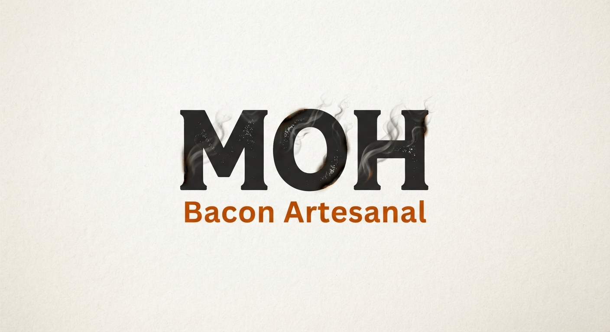

# MOH Bacon Artesanal

Site estático de apresentação e vendas da **MOH Bacon Artesanal**, produtora de bacon artesanal desde 2023. A página mostra os produtos, os preços e leva o cliente direto aos anúncios no Mercado Livre.

**Site no ar:** https://danbrdo.github.io/MOH-Bacon-Artesanal/

## Produtos

| Produto | Anúncio |
| --- | --- |
| Bacon em pedaço (500 g) | [Mercado Livre](https://www.mercadolivre.com.br/bacon-artesanal-suino-moh-500g/up/MLBU5530199240?pdp_filters=item_id:MLB5391971743) |
| Bacon fatiado (500 g) | [Mercado Livre](https://www.mercadolivre.com.br/moh-bacon-fatiado-500g/up/MLBU5412244793?pdp_filters=item_id:MLB5358977007) |

## Funcionalidades

- Topo com logo, título e botão que leva à seção de preços.
- Galeria de fotos em carrossel (setas, deslizar no celular e navegação pelo teclado). Fotos que não carregam são removidas automaticamente.
- Quadro de preços com um botão de compra para cada produto.
- Layout responsivo, pensado primeiro para o celular.
- Pré-visualização ao compartilhar o link (logo e título no WhatsApp e redes sociais).
- Cuidados de segurança: política de conteúdo (CSP), links externos com `noopener noreferrer` e aceitação apenas de links `https://`.

## Tecnologias

- HTML5, CSS3 e JavaScript puro, tudo em um único arquivo (`index.html`)
- Fontes do Google Fonts (Bitter e Source Sans 3)
- Hospedagem gratuita no GitHub Pages

## Estrutura do repositório

```
.
├── index.html     # página inicial (HTML, CSS e JavaScript)
├── logo.jpg       # logo da marca
├── fotos/         # fotos da galeria (foto1.jpg, foto2.jpg, ...)
└── README.md
```

## Como visualizar no computador

Não precisa instalar nada. Escolha uma das opções:

1. **Live Server (VS Code):** abra a pasta do projeto, clique com o botão direito em `index.html` e escolha **Open with Live Server**. A página atualiza sozinha ao salvar.
2. **Duplo clique** no `index.html` para abrir direto no navegador.
3. **Python:** na pasta do projeto, rode `python -m http.server 8000` e abra `http://localhost:8000`.

## Como atualizar o conteúdo

**Preços e links de compra:** no final do `index.html`, dentro da tag `<script>`, edite os blocos de configuração:

```js
const LINKS = {
  peca: "https://...",     // anúncio do bacon em pedaço
  fatiado: "https://..."   // anúncio do bacon fatiado
};
const PRECOS = { peca: 39.90, fatiado: 45.90 };  // valores por 500 g
```

Os preços são escritos uma única vez e aplicados em toda a página. Links que não começam com `https://` são ignorados, e o botão aparece como "Em breve".

**Fotos:** coloque os arquivos na pasta `fotos/` com nomes em minúsculas (`foto1.jpg`, `foto2.jpg`...). Para incluir uma foto nova, adicione uma linha dentro do carrossel:

```html
<figure></figure>
```

**Textos:** edite diretamente o HTML do `index.html`.

## Publicação

O site é publicado pelo GitHub Pages a partir da branch `main`:

1. No repositório, abra **Settings → Pages**.
2. Em **Source**, escolha **Deploy from a branch**.
3. Selecione a branch `main` e a pasta `/ (root)`, e clique em **Save**.

A cada `git push` (ou edição feita pelo site do GitHub), a página é atualizada em 1 a 3 minutos. Na conta gratuita, o repositório precisa ser **público**.

## Próximos passos

- [ ] Incluir mais fotos na galeria
- [ ] Adicionar outras formas de compra, se necessário
- [ ] Domínio próprio (por exemplo, `mohbaconartesanal.com.br`)

## Licença e contato
e-mail:daniel.oliverbarros@gmail.com
